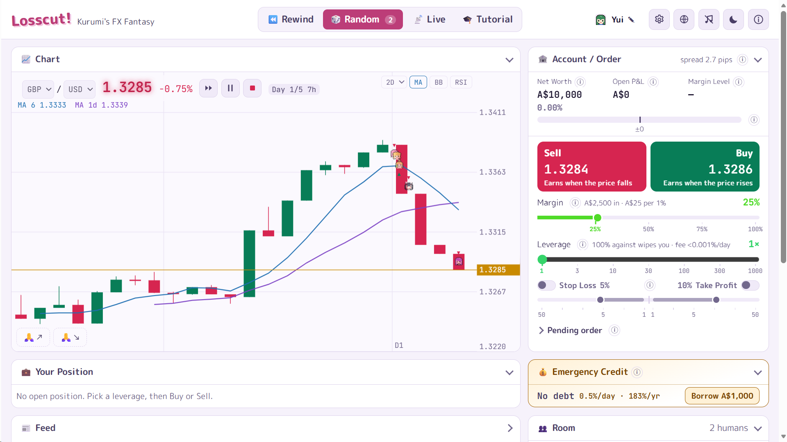
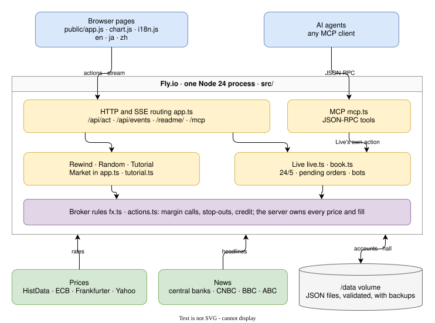

# Losscut! Kurumi's FX Fantasy

A shared currency market where everyone on a tab trades one price with play money, and the room watches you lose it.

- Rewind replays a real crisis, with the dates hidden until the bell.
- Random draws a market from today's rate and a hidden situation.
- Live trades real prices until you go bankrupt.

Pick a name and press Start. A second browser profile sees each trade within a second.

[日本語](https://github.com/comp4020-agentic-coding-studio/comp4020-final-petrewei/blob/main/docs/readme/ja.md) · [中文](https://github.com/comp4020-agentic-coding-studio/comp4020-final-petrewei/blob/main/docs/readme/zh.md)

The [wiki](https://github.com/comp4020-agentic-coding-studio/comp4020-final-petrewei/wiki) is the full guide.

Any MCP client can trade Live over HTTP, no key: `claude mcp add --transport http losscut https://comp4020-final-petrewei.fly.dev/mcp`.

## Who it is for

A room playing together: a crit group or the showcase. Like Shirky's situated software, it is made for one group.

It parodies *FX Fighter Kurumi-chan* (Demunyan and Daisuki Tansan; anime by Passione, 2026), in which a student trades leveraged forex to win back what her family lost in 2008.

## What good means here

Good means a room laughing at a wipe-out, then understanding why. Leverage is the joke and the lesson: offshore brokers sell 1000×, ESMA caps it at 30×, and most retail accounts lose.

- One price, one room: the server owns every price and fill, and the room sees which way you trade.
- Losing is public: a stop-out (強制ロスカット) appears in the feed, and emergency credit charges a loan shark's rate.
- The past is a trap: Rewind plays five real days around one of nineteen breaks, from Lehman to the franc's unpegging, named only at the bell.
- Risk is shown in money: the ticket says what a 1% move costs, and the bell replays your biggest trade at 1×, 30× and 1000×.
- Company, then rivals: seven comic characters trade beside you, and you can duel a person.
- Beginners start safe: ten lessons that end in a wipe-out.

## Enforced and judged

Checked in CI before each deploy by `spec/` and `test/`, with the reasons in the [decision records](https://github.com/comp4020-agentic-coding-studio/comp4020-final-petrewei/blob/main/docs/adr/README.md):

- one person's trade reaches another's page within a second
- a round waits for a Start, and simultaneous orders land on each sender's own account
- the server refuses orders its broker lacks
- nobody sees another's cookie; a chosen name is plain text and unique
- margin calls, stop-outs, credit and bankruptcy follow `src/fx.ts`
- Rewind passes every real close, and a clue never names its date
- a Live account survives a restart, and a damaged save recovers from its backup
- every string has English, Japanese and Chinese, each at its own address
- every action a page offers reaches the server

Judged by people:

- whether a room laughs and learns at the bell
- whether leverage looks as dangerous as it is
- whether the Japanese and Chinese read as native

## What I looked at

- [*FX Fighter Kurumi-chan*](https://en.wikipedia.org/wiki/FX_Fighter_Kurumi-chan) and its [anime site](https://fxkurumi-info.com/),.
- ESMA's [2018 restriction on retail CFDs](https://www.esma.europa.eu/press-news/esma-news/esma-agrees-prohibit-binary-options-and-restrict-cfds-protect-retail-investors): 74 to 89% of retail accounts lose money; major pairs are capped at 30:1.
- After the franc unpegged, FXCM's clients owed it [$225 million](https://money.cnn.com/2015/01/16/investing/swiss-currency-fxcm/index.html).
- Prices from [HistData](https://www.histdata.com/), the [ECB](https://www.ecb.europa.eu/stats/policy_and_exchange_rates/euro_reference_exchange_rates/html/index.en.html), [Frankfurter](https://frankfurter.dev/) and Yahoo Finance.
- Clay Shirky, ["Situated Software"](https://gwern.net/doc/technology/2004-03-30-shirky-situatedsoftware.html) (2004): software for one group.

## Left out

Real money, broker links, deposit offers, and the series' music and art. The comic's family tragedy is the premise, never a joke.

If gambling or debt is hurting you, Australia's [Gambling Help](https://www.gamblinghelponline.org.au/) line is 1800 858 858.
